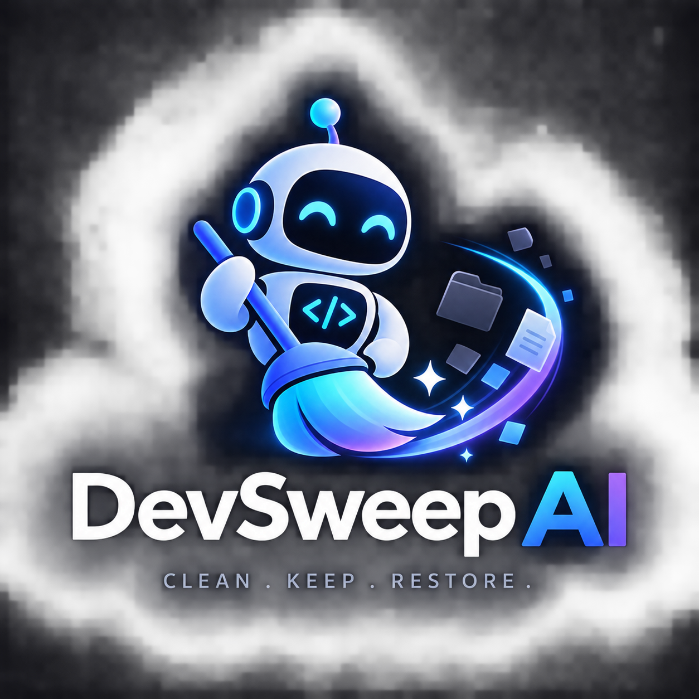

# DevSweep AI

<p align="center"></p>

> Clean your workspace. Keep your project. Restore it anytime.

DevSweep AI helps students and independent developers find storage-heavy project artifacts, understand the risks, review an exact cleanup plan, and recover removed content from a verified backup.

**WarriorHacks 2.0 · Code Hackathon project**

- **Repository:** [Drishya-code/DevSweep-AI-WarriorHacks](https://github.com/Drishya-code/DevSweep-AI-WarriorHacks)
- **Demo guide:** [docs/DEMO.md](docs/DEMO.md)
- **Submission draft and current evidence:** [docs/DEVPOST_DRAFT.md](docs/DEVPOST_DRAFT.md)
- **Demo production notes:** [docs/submission/demo/](docs/submission/demo/)

## Why it exists

Project installs, build outputs, caches, logs, and temporary files can consume substantial disk space. Removing unfamiliar folders by guesswork can break a project or lose useful data. DevSweep shows what it found, why it is a candidate, and what a proposed cleanup would affect before asking the user to approve it.

## How it works

1. Select an authorized local project or the isolated synthetic demo workspace.
2. Scan with deterministic filesystem rules and display candidate paths, measured sizes, and risk labels.
3. Optionally request recommendations from NVIDIA Nemotron through Nebius Token Factory.
4. Review a plan based only on scanner-discovered candidates. The backend keeps the authoritative risk and access checks.
5. Approve cleanup explicitly. The backend saves and verifies a content backup before removing each item.
6. Inspect execution and project-integrity results separately. Restore a verified backup only after approval, and never overwrite an existing destination.

The model recommends; deterministic backend checks and the user govern filesystem changes. A configured provider is not proof of live inference: the application reports live analysis only after a real request succeeds. Mock responses cannot authorize cleanup.

## Safety model

- The backend is intended for local use and binds to loopback by default. It rejects non-loopback binding until authenticated remote access exists.
- Project paths are canonicalized and access is revalidated. External projects require a temporary, folder-scoped grant.
- Cleanup targets must be top-level candidates discovered by the scanner and pass fresh backend checks at execution time.
- Source, Git history, credentials, environment files, and protected configuration are excluded. Dangerous items cannot be deleted; caution items need explicit approval.
- A backup must pass content and SHA-256 manifest checks before deletion can proceed. Restore requires a matching authorized project and a destination that does not already exist.
- Backups are unencrypted, retained until managed by the user, and do not preserve ownership or platform ACLs. Treat them as sensitive project data.
- Verification checks recorded project and protected-file state. It does not run the project's build or test suite automatically.

## Run locally

Requirements: Python 3.10 or later, Node.js/npm, and Git for Git status detection. Use two PowerShell terminals from the repository root.

Prepare dependencies and the synthetic fixture:

```powershell
if (-not (Test-Path .\backend\.venv\Scripts\python.exe)) { py -m venv .\backend\.venv }
.\backend\.venv\Scripts\python.exe -m pip install -r .\backend\requirements.txt
Set-Location .\frontend
npm.cmd ci
Set-Location ..
.\backend\.venv\Scripts\python.exe .\generate_demo.py
if (-not (Test-Path .\.env)) { Copy-Item .\.env.example .\.env }
```

Set `DEVSWEEP_WORKSPACE_ROOT` in the root `.env` to this checkout's absolute path. Add a real `NEBIUS_API_KEY` there only if you intend to use live inference. Never commit `.env` or paste keys into screenshots, logs, or frontend variables.

Terminal 1 — backend:

```powershell
Set-Location 'C:\path\to\DevSweep-AI-WarriorHacks'
$env:DEVSWEEP_WORKSPACE_ROOT = (Resolve-Path .).Path
Set-Location .\backend
..\.venv\Scripts\python.exe -m uvicorn main:app --reload --host 127.0.0.1 --port 8000
```

Terminal 2 — frontend:

```powershell
Set-Location 'C:\path\to\DevSweep-AI-WarriorHacks\frontend'
npm.cmd run dev -- --host 127.0.0.1
```

Open the local URL Vite prints (usually `http://127.0.0.1:5173`). In PowerShell, `npm.cmd` avoids execution-policy errors that can block `npm.ps1`. If port 8000 is already occupied, check for an existing backend before starting another one.

See [the complete synthetic demo walkthrough](docs/DEMO.md) for fixture reset, review and restore steps, recording guidance, and limitations.

## Configuration

| Variable | Purpose | Default |
| --- | --- | --- |
| `NEBIUS_API_KEY` | Nebius Token Factory credential for live model requests | unset |
| `NEBIUS_BASE_URL` | OpenAI-compatible provider base URL | `https://api.tokenfactory.us-central1.nebius.com/v1/` |
| `NEBIUS_MODEL` | Model used for recommendations and agent chat | `nvidia/nemotron-3-super-120b-a12b` |
| `DEVSWEEP_WORKSPACE_ROOT` | Workspace boundary for project access | backend working directory |
| `DEVSWEEP_DB_PATH` | SQLite application history location | `./data/devsweep.db` |
| `DEVSWEEP_BACKUP_ROOT` | Separate verified backup store | per-user application data folder |
| `DEVSWEEP_DEMO_MODE` | Force mock provider for non-destructive development | `false` |

See [.env.example](.env.example) and [backend/config.py](backend/config.py) for configuration details.

## Development checks

Run from the repository root:

```powershell
Set-Location .\backend
..\.venv\Scripts\python.exe -m pytest -q -p no:cacheprovider
Set-Location ..\frontend
npm.cmd test
npm.cmd run build
```

## Project layout

```text
backend/       FastAPI routes, scanner, safety engine, backups, SQLite history
frontend/      React, TypeScript, Vite interface and tests
demo-project/  Local-only synthetic fixture, generated by generate_demo.py
docs/          Setup, demo, and hackathon submission materials
generate_demo.py
```

The demo fixture is generated locally and ignored by Git. Resetting it does not reset application history or delete verified backups. Do not use the real repository as a destructive demo target.

## Current submission status

The repository includes the application, reproducible synthetic fixture generator, demo walkthrough, submission draft, and demo production notes. **Genuine screenshots and a final demo video are not currently included**; capture them from the live app and add the verified links before claiming those deliverables in a submission. See the evidence and remaining steps in [docs/DEVPOST_DRAFT.md](docs/DEVPOST_DRAFT.md).

## License

MIT. See [LICENSE](LICENSE).
