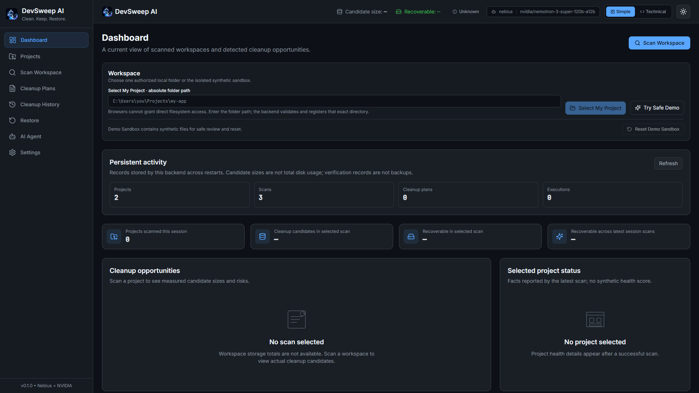
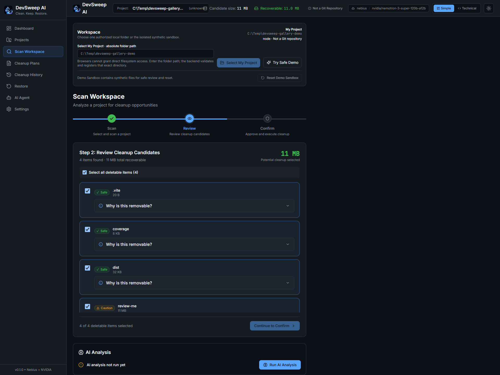
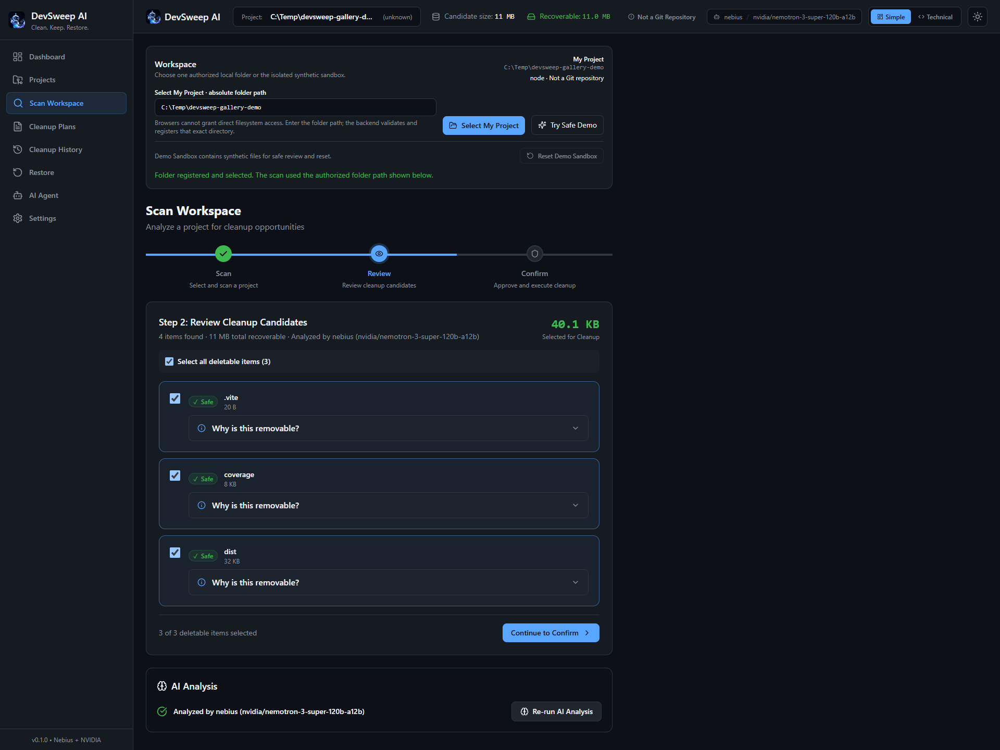

# DevSweep AI

<p align="center"></p>

> Clean your workspace. Keep your project. Restore it anytime.

DevSweep AI helps students and independent developers find storage-heavy project artifacts, understand the risks, review an exact cleanup plan, and recover removed content from a verified backup.

**WarriorHacks 2.0 · Code Hackathon project**

- **Repository:** [Drishya-code/DevSweep-AI-WarriorHacks](https://github.com/Drishya-code/DevSweep-AI-WarriorHacks)
- **Demo video:** [Watch DevSweep AI on YouTube](https://youtu.be/9oGs6lo1hrc)
- **Demo guide:** [docs/DEMO.md](docs/DEMO.md)
- **Submission draft and current evidence:** [docs/DEVPOST_DRAFT.md](docs/DEVPOST_DRAFT.md)
- **Demo production notes:** [docs/submission/demo/](docs/submission/demo/)

## Why it exists

Project installs, build outputs, caches, logs, and temporary files can consume substantial disk space. Removing unfamiliar folders by guesswork can break a project or lose useful data. DevSweep shows what it found, why it is a candidate, and what a proposed cleanup would affect before asking the user to approve it.

## How it works

1. Select an authorized local project or the isolated synthetic demo workspace.
2. Scan with deterministic filesystem rules and display candidate paths, measured sizes, and risk labels.
3. Optionally request recommendations from NVIDIA Nemotron through Nebius Token Factory.
4. Review a plan based only on scanner-discovered candidates. The backend keeps the authoritative risk and access checks.
5. Approve cleanup explicitly. The backend saves and verifies a content backup before removing each item.
6. Inspect execution and project-integrity results separately. Restore a verified backup only after approval, and never overwrite an existing destination.

The model may recommend; deterministic backend checks and the user govern filesystem changes. A fresh deterministic scan can create a review-only plan without AI. A configured provider is not proof of live inference: the application reports live analysis only after a real request succeeds. Mock output is not used to select plan contents.

## Safety model

- The backend is intended for local use and binds to loopback by default. It rejects non-loopback binding until authenticated remote access exists.
- Project paths are canonicalized and access is revalidated. External projects require a temporary, folder-scoped grant.
- Cleanup targets must be top-level candidates discovered by the scanner and pass fresh backend checks at execution time.
- Source, Git history, credentials, environment files, and protected configuration are excluded. Dangerous items cannot be deleted; caution items need explicit approval.
- A backup must pass content and SHA-256 manifest checks before deletion can proceed. Restore requires a matching authorized project and a destination that does not already exist.
- Backups are unencrypted, retained until managed by the user, and do not preserve ownership or platform ACLs. Treat them as sensitive project data.
- Verification checks recorded project and protected-file state. It does not run the project's build or test suite automatically.

## Run locally

Requirements: Python 3.10 or later and Node.js 18 or later. Git is optional and enables Git status detection. No AI account or API key is required to explore scanning and deterministic review plans.

### Windows quick start (no key required)

Open PowerShell in the cloned repository and run:

```powershell
Set-ExecutionPolicy -Scope Process -ExecutionPolicy Bypass
.\Start-DevSweep.ps1
```

The script checks prerequisites, installs dependencies only when the backend environment or frontend packages are missing, creates the synthetic fixture only if absent, starts both services on loopback, opens the app, and stops them with `Ctrl+C`. It does not create or overwrite `.env`. If PowerShell blocks the first command, use a session-only policy with `powershell.exe -NoProfile -ExecutionPolicy Bypass -File .\Start-DevSweep.ps1`. Add `-CheckOnly` to validate setup without starting services or `-SkipInstall` to prevent dependency installation.

For optional live Nebius inference, create or edit the private root `.env` using [.env.example](.env.example) as a reference, set your own `NEBIUS_API_KEY`, then run `.\Start-DevSweep.ps1 -LiveAI`. The script never prints the key or sends it to the browser. A configured key alone does not prove inference; confirm a successful provider/model label after an analysis request.

### Manual no-key setup

From the repository root:

```powershell
if (-not (Test-Path .\backend\.venv\Scripts\python.exe)) { py -m venv .\backend\.venv }
 .\backend\.venv\Scripts\python.exe -m pip install -r .\backend\requirements.txt
if (-not (Test-Path .\frontend\node_modules\vite\bin\vite.js)) { Push-Location .\frontend; npm.cmd ci; Pop-Location }
if (-not (Test-Path .\demo-project)) { .\backend\.venv\Scripts\python.exe .\generate_demo.py }
```

Terminal 1 — backend:

```powershell
Set-Location 'C:\path\to\DevSweep-AI-WarriorHacks'
$env:DEVSWEEP_WORKSPACE_ROOT = (Resolve-Path .).Path
$env:DEVSWEEP_DEMO_MODE = 'true'
$env:NEBIUS_API_KEY = ''
Set-Location .\backend
..\.venv\Scripts\python.exe -m uvicorn main:app --host 127.0.0.1 --port 8000
```

Terminal 2 — frontend:

```powershell
Set-Location 'C:\path\to\DevSweep-AI-WarriorHacks\frontend'
npm.cmd run dev -- --host 127.0.0.1
```

Open `http://127.0.0.1:5173`. In PowerShell, `npm.cmd` avoids execution-policy errors that block `npm.ps1`. Check that an earlier service is not occupying port 8000 or 5173 before starting another.

See [the complete synthetic demo walkthrough](docs/DEMO.md) for fixture reset, no-key cleanup, approval, restore steps, recording guidance, and limitations.

## Configuration

| Variable | Purpose | Default |
| --- | --- | --- |
| `NEBIUS_API_KEY` | Nebius Token Factory credential for live model requests | unset |
| `NEBIUS_BASE_URL` | OpenAI-compatible provider base URL | `https://api.tokenfactory.us-central1.nebius.com/v1/` |
| `NEBIUS_MODEL` | Model used for recommendations and agent chat | `nvidia/nemotron-3-super-120b-a12b` |
| `DEVSWEEP_WORKSPACE_ROOT` | Workspace boundary for project access | backend working directory |
| `DEVSWEEP_DB_PATH` | SQLite application history location | `./data/devsweep.db` |
| `DEVSWEEP_BACKUP_ROOT` | Separate verified backup store | per-user application data folder |
| `DEVSWEEP_DEMO_MODE` | Force mock provider for non-destructive development | `true` in `.env.example`; launcher no-key default |

See [.env.example](.env.example) and [backend/config.py](backend/config.py) for configuration details.

## Development checks

Run from the repository root:

```powershell
Set-Location .\backend
..\.venv\Scripts\python.exe -m pytest -q -p no:cacheprovider
Set-Location ..\frontend
npm.cmd test
npm.cmd run build
```

**Verified for this revision (14 October 2026):** backend **126 passed, 3 skipped**; frontend **66 passed across 13 files**; production build **passed**. The backend emits an existing Pydantic class-based configuration deprecation warning. Frontend tests emit existing React Router future-flag and React `act(...)` warnings. The repository's `npm run lint` script currently fails because no ESLint configuration is present; TypeScript checking is included in the successful production build.

## Project layout

```text
backend/       FastAPI routes, scanner, safety engine, backups, SQLite history
frontend/      React, TypeScript, Vite interface and tests
demo-project/  Local-only synthetic fixture, generated by generate_demo.py
docs/          Setup, demo, and hackathon submission materials
generate_demo.py
```

The demo fixture is generated locally and ignored by Git. Resetting it does not reset application history or delete verified backups. Do not use the real repository as a destructive demo target.

## Real application screenshots

These are genuine captures from the running DevSweep application. The gallery manifest identifies which entries are application screenshots and which are designed graphics, with context for each.

| Dashboard | Scan and risk review | Live AI analysis |
|---|---|---|
|  |  |  |

See [the complete gallery](docs/submission/devpost-gallery/README.md) for more screenshots. The demo link above is the exact public URL supplied by the project owner. [Production notes](docs/submission/demo/production-notes.md) distinguish the YouTube upload from the source clips available in this repository and from earlier live workflow evidence.

## Judge and submission references

- [Windows and manual demo walkthrough](docs/DEMO.md)
- [Judge quick guide (Markdown)](docs/submission/DevSweep-AI-Judges-Quick-Guide.md) · [PDF](docs/submission/DevSweep-AI-Judges-Quick-Guide.pdf)
- [Devpost draft](docs/DEVPOST_DRAFT.md)
- [Gallery and evidence manifest](docs/submission/devpost-gallery/gallery-manifest.md)
- [Demo verification report](docs/submission/demo/verification-report.md)
- [Demo video production notes](docs/submission/demo/production-notes.md)

## Known limitations

Live AI needs a judge's own Nebius key and network access. Artifact detection covers a bounded set of common patterns. External-folder grants are temporary. Backups are unencrypted and do not preserve ownership or platform ACLs. Verification checks filesystem and protected-file state; it does not run project builds or tests. Backing up large directories can take minutes. See [the demo guide](docs/DEMO.md) and [safety notes](docs/DEVPOST_DRAFT.md) for details.

## License

MIT. See [LICENSE](LICENSE).
